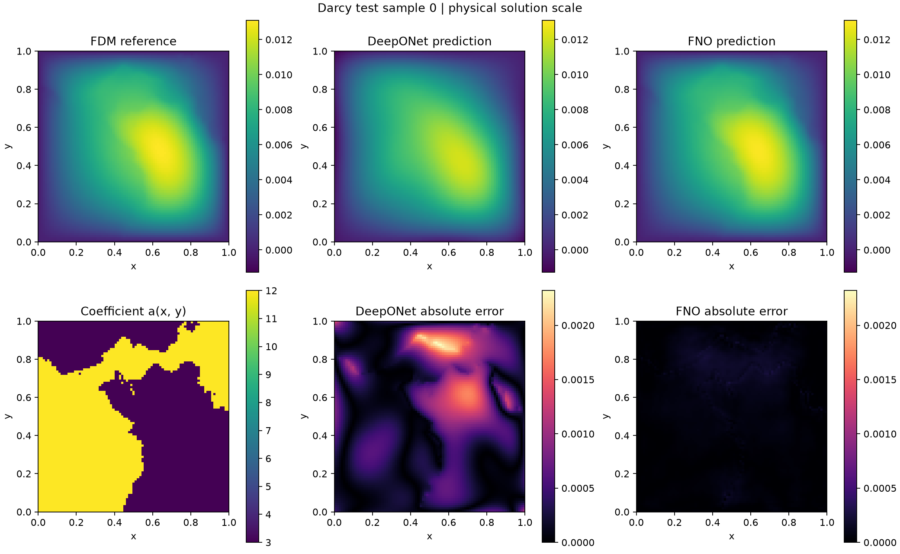

# OperatorBench

OperatorBench provides a reproducible workflow for comparing DeepONet
and Fourier Neural Operator (FNO) on PDE operator-learning tasks.

The current benchmark covers 2D Darcy flow.

## Workflow

```text
Generate data -> Train -> Predict -> Evaluate -> Visualize
```

| Stage | Main operation | Output |
| --- | --- | --- |
| Generate data | Sample coefficient fields and solve the PDE numerically. | Training, validation, and test datasets |
| Train | Fit preprocessing on training data, optimize the model, and select it using validation data. | Model checkpoint and preprocessing statistics |
| Predict | Apply the trained model to coefficient fields using saved preprocessing. | Predicted solution fields |
| Evaluate | Compare predictions with reference solutions. | Per-sample and aggregate errors |
| Visualize | Plot user-selected samples. | Coefficient, reference, prediction, and error figures |

The current evaluation command performs prediction, error calculation,
and visualization together. It evaluates the original held-out test set.

## Current Darcy benchmark

We learn the coefficient-to-solution map `a -> u`:

$$
-\nabla \cdot (a(x)\nabla u(x)) = 1,
\qquad x \in (0,1)^2,
\qquad u|_{\partial\Omega}=0.
$$

| Item | Current setting |
| --- | --- |
| Coefficient | Binary random fields with values 3 and 12 |
| Boundary condition | Homogeneous Dirichlet |
| Grid | 85 x 85 nodes, including boundaries |
| Reference solver | Flux-form five-point finite differences with arithmetic face averages |
| Train / validation / test | 1,000 / 200 / 200 samples |
| Models | Fully connected DeepONet and FNO |
| Training budget | 25,000 optimizer updates per model |

## Configuration

Training settings are defined in
[configs/darcy_baseline.json](configs/darcy_baseline.json).
Select a configuration file with `--config` when running
`scripts.train_darcy`.

| Setting | Purpose |
| --- | --- |
| `dataset` | Path to the saved dataset, relative to the repository root |
| `N`, `split_sizes`, `split_seeds` | Expected dataset metadata, checked when loading |
| `model_init_seed` | Seed used to initialize the model |
| `cpu_threads` | Number of PyTorch CPU threads |
| `training.num_steps` | Total number of optimizer updates |
| `training.batch_size` | Number of samples per optimizer update |
| `training.learning_rate`, `training.weight_decay` | Optimizer settings |
| `training.scheduler_step_size`, `training.scheduler_gamma` | Learning-rate decay interval in optimizer updates and decay factor |
| `training.validate_every`, `training.eval_batch_size` | Validation interval in optimizer updates and evaluation batch size |
| `training.sampling_seed` | Seed for training-batch sampling |
| `models.deeponet` | Sensor count, branch/trunk widths, latent dimension, and boundary constraint |
| `models.fno` | Fourier modes and channel width |

To customize an experiment, copy the baseline JSON file, edit the relevant
settings, and pass the new file with `--config`. Use a new `--run-name`
for each new experiment.

The current data-generation command uses settings defined in
`scripts/generate_darcy_splits.py`. Editing `N`, `split_sizes`, or
`split_seeds` in the training configuration does not regenerate data.
Dataset settings and model input dimensions must remain consistent.

Evaluation restores the model configuration and preprocessing statistics
from the checkpoint; it does not take a training configuration file.

## Run from a terminal

Run all commands from the repository root.

### 1. Set up the environment

Git and Python are required.

```bash
git clone https://github.com/HJang0820/OperatorBench.git
cd OperatorBench
python -m venv .venv
```

On Linux, activate the environment:

```bash
source .venv/bin/activate
```

On Windows PowerShell, replace `python` in the commands below with
`.\.venv\Scripts\python.exe`; activation is not required.

Install the dependencies for CPU execution on Linux or Windows:

```bash
python -m pip install numpy scipy matplotlib
python -m pip install torch --index-url https://download.pytorch.org/whl/cpu
```

For other platforms or CUDA, follow the
[official PyTorch installation instructions](https://pytorch.org/get-started/locally/).
With a compatible CUDA environment, use `--device cuda` in the commands below.

### 2. Generate the dataset

```bash
python -m scripts.generate_darcy_splits
```

This generates and saves the 1,000/200/200 dataset split.
A matching cached dataset is loaded and checked instead of regenerated.

### 3. Train both models

```bash
python -u -m scripts.train_darcy --config configs/darcy_baseline.json --model deeponet --device cpu --run-name darcy_deeponet_01
python -u -m scripts.train_darcy --config configs/darcy_baseline.json --model fno --device cpu --run-name darcy_fno_01
```

Run the commands sequentially. Full training can take several hours on CPU.

Each run saves its results under `outputs/<run-name>/`:

- `best.pt`: the model selected using validation error.
- `last.pt`: the state used to resume training.

Use a new run name for a new experiment.
To resume an interrupted run, add `--resume` to its original training
command, keeping the source code, settings, and execution environment unchanged.

### 4. Predict, evaluate, and visualize

```bash
python -u -m scripts.evaluate_darcy --device cpu --deeponet-checkpoint outputs/darcy_deeponet_01/best.pt --fno-checkpoint outputs/darcy_fno_01/best.pt --output-dir outputs/darcy_evaluation_01 --sample-indices 0 5 19
```

This command evaluates all 200 test samples and plots samples 0, 5, and 19.
Sample indices are zero-based. Selecting figures does not change the
samples used to calculate the aggregate metrics.

Results are saved in `outputs/darcy_evaluation_01/`:

| File | Contents |
| --- | --- |
| `comparison.csv` | Aggregate metrics for both models |
| `per_sample.csv` | Errors for every test sample |
| `predictions.npz` | Inputs, references, coordinates, and predictions |
| `sample_*.png` | Figures for the selected samples |
| `summary.json` | Evaluation settings and provenance |

Choose a new output directory when repeating an evaluation.

### Evaluate existing checkpoints

If trained checkpoints are already available, skip data generation and
training. Use the evaluation command above with their checkpoint paths.

The evaluator requires the original dataset file and matching
model/preprocessing source files. Use `--dataset PATH` if the original
dataset is stored at a different location.

Datasets and checkpoints are not included in a repository clone.
No pretrained-checkpoint download release is currently provided.

## Initial results

Both models were trained on CPU and evaluated on the same 200 test samples.
The reported results use one training initialization seed per model.

| Model | Mean test relative L2 (%) |
| --- | ---: |
| DeepONet | 6.2474 |
| FNO | 0.7630 |

Relative L2 error is calculated per sample and then averaged.
Maximum absolute errors are also reported after restoring the physical
solution scale.

- [Detailed metrics](docs/results/darcy_test_seed2026_01/comparison.csv)
- [Experiment settings and environments](docs/results/darcy_test_seed2026_01/metadata.json)



These scores describe this experiment, not general model rankings.
Reference accuracy for discontinuous coefficients requires further validation.

## Directory tour

```text
OperatorBench/
├── configs/                    # Experiment configuration files
├── operatorbench/
│   ├── data_generation/        # Input fields, numerical solvers, and dataset assembly
│   ├── data/                   # Loading, normalization, and model input preparation
│   ├── models/                 # DeepONet and FNO architectures
│   ├── losses.py               # Training loss functions
│   ├── training.py             # Optimization, validation, and checkpoint recovery
│   ├── evaluation.py           # Batched validation metrics
│   └── inference.py            # Predictions and physical-scale errors
├── scripts/                    # Workflow entry points and development checks
└── docs/                       # Numerical verification and published results
```

The main workflow entry points are:

| Command | Purpose |
| --- | --- |
| `python -m scripts.generate_darcy_splits` | Generate or load the saved dataset splits |
| `python -m scripts.train_darcy` | Train a selected model or resume training |
| `python -m scripts.evaluate_darcy` | Predict, evaluate, and plot selected test samples |
| `python -m scripts.export_darcy_report` | Export evaluation results for documentation |

The commands above identify the entry points. See
[Run from a terminal](#run-from-a-terminal) for complete commands, or
use `--help` with the training and evaluation commands for available options.

Generated datasets are stored locally under `data/`, and experiment
outputs under `outputs/`. Both directories are excluded from Git.

Numerical verification details are documented in
[Numerical verification](docs/numerical-verification.md).


## References

- [DeepONet](https://doi.org/10.1038/s42256-021-00302-5)
- [Fourier Neural Operator](https://arxiv.org/abs/2010.08895)
- [A comprehensive and fair comparison of two neural operators](https://arxiv.org/abs/2111.05512)
- [PDEBench](https://arxiv.org/abs/2210.07182)
- [SPDEBench](https://arxiv.org/abs/2505.18511)