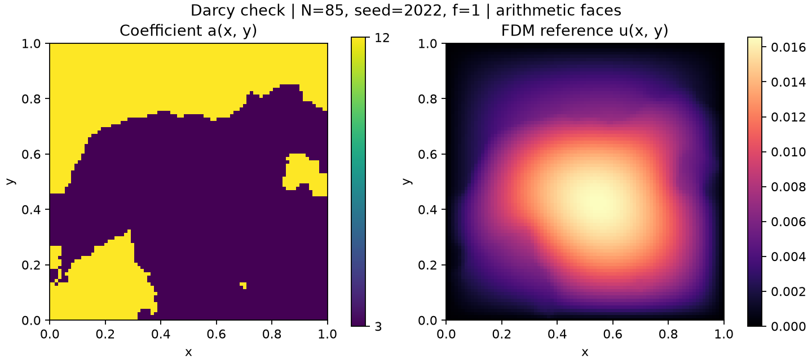

# OperatorBench

OperatorBench is a research project for reproducible comparisons of
DeepONet and Fourier Neural Operator (FNO) on PDE operator-learning tasks.

The immediate focus is a complete 2D Darcy workflow:
data generation, storage, preprocessing, model training, and evaluation.
Burgers experiments are planned as a subsequent extension.

## Current status

Preliminary Darcy experiments were conducted in Jupyter notebooks.
The existing implementation is being migrated into reusable Python modules.

The coefficient generator, finite-difference solver, and diagnostic
plotting script have been extracted into reusable modules.

The solver now accepts either a scalar source or an `(N, N)` source array
on the same grid as the coefficient field. The original constant-source
diagnostic continues to pass.

A smooth, constant-coefficient manufactured-solution test has been added.
Grid refinement on 17 x 17, 33 x 33, and 65 x 65 grids shows approximately
second-order convergence.

Constant and sine source generators are now implemented and checked.

A small coefficient-to-solution (`a_to_u`) dataset can be generated using
the migrated notebook workflow. The current smoke test generates
10 samples on an 85 x 85 grid with a shared constant source `f = 1`,
saves the fields and generation metadata, and verifies exact array
equality after loading the saved file.

The complete modular training and evaluation pipeline is not yet available.

## Darcy problem

We consider the steady elliptic problem

$$
-\nabla \cdot (a(x)\nabla u(x)) = f(x),
\qquad x \in (0,1)^2,
$$

with homogeneous Dirichlet boundary conditions:

$$
u(x) = 0, \qquad x \in \partial\Omega.
$$

Here, `a` is the positive coefficient field, `f` is the source term,
and `u` is the solution field.

### Current diagnostic configuration

- Model input for the initial task: coefficient field `a`.
- Source term: `f = 1`.
- Coefficient values: `3` and `12`.
- Coefficient generation: thresholding a random cosine-basis expansion.
- The constant mode of the underlying random field is set to zero.
- Grid: `85 x 85` nodes, including boundary nodes.
- Boundary conditions: zero Dirichlet conditions on all four sides.
- Solver: flux-form five-point finite differences.
- Face coefficients: arithmetic averages of adjacent nodal coefficients.
- Linear system: solved using SciPy's sparse direct solver.

This is a locally generated baseline dataset configuration.
Exact equivalence to the original public FNO dataset has not been established.

### Planned input configurations

| Task | Model input | Fixed information |
| --- | --- | --- |
| `a_to_u` | Coefficient field `a` | A prescribed source, initially `f = 1` |
| `f_to_u` | Source field `f` | One prescribed coefficient field shared across samples |
| `af_to_u` | Coefficient and source fields `(a, f)` | Domain and boundary conditions |

The binary-coefficient diagnostic uses the constant source `f = 1`.
The numerical solver also supports spatially varying source arrays.

Constant and sine source generators are available.
The current dataset builder applies one shared source field to all samples.

Sample-varying source generation and the complete `f_to_u` and `af_to_u`
learning pipelines remain planned.

### Planned coefficient distributions

- Binary, discontinuous coefficients: current implementation.
- Positive lognormal coefficients with configurable spatial regularity: planned.

For lognormal coefficients, spatial regularity will be controlled by
the underlying Gaussian field. Exponentiation alone does not specify smoothness.

## Run the current Darcy diagnostic

Run the following commands from the repository root in your Python environment.

Install the diagnostic dependencies:

```bash
python -m pip install numpy scipy matplotlib
```

Run the checks and generate the figure:

```bash
python -m scripts.check_darcy
```

The script generates one coefficient field, computes its finite-difference
solution, checks basic properties, evaluates the discrete residual,
and saves a diagnostic figure.

Successful execution includes:

```text
Basic solver checks passed.
```

The figure is saved to:

```text
docs/figures/darcy_sample_N85_seed2022.png
```

### Example coefficient and finite-difference solution



This figure shows a numerical solution, not a neural-network prediction.
A small discrete residual checks consistency with the discrete equations;
it does not establish continuum accuracy or grid convergence.

## Numerical verification

### Source-array support and grid refinement

Run the verification script from the repository root:

```bash
python -m scripts.check_darcy_source
```

The script first checks that a scalar source `f = 1` and an equivalent
constant source array produce matching numerical solutions.

It then solves a manufactured-solution problem on the unit square with
homogeneous Dirichlet boundary conditions:

$$
a(x,y)=1,
$$

$$
u_{\mathrm{exact}}(x,y)=\sin(\pi x)\sin(2\pi y),
$$

$$
f(x,y)=5\pi^2\sin(\pi x)\sin(2\pi y).
$$

The same continuous problem is evaluated on each grid.
Each grid contains `N x N` nodes, including boundary nodes, with
spacing `h = 1 / (N - 1)`.

The relative L2 error is computed from the sampled solution arrays:

$$
E_h =
\frac{\|u_h-u_{\mathrm{exact}}\|_2}
{\|u_{\mathrm{exact}}\|_2}.
$$

### Results

| Grid size | Grid spacing | Relative L2 error | Observed order |
| --- | --- | --- | --- |
| 17 x 17 | 1/16 | 1.098931e-02 | — |
| 33 x 33 | 1/32 | 2.734955e-03 | 2.0065 |
| 65 x 65 | 1/64 | 6.829684e-04 | 2.0016 |

The observed order compares each grid with the preceding coarser grid:

$$
p =
\frac{\log(E_{\mathrm{coarse}}/E_{\mathrm{fine}})}
{\log(h_{\mathrm{coarse}}/h_{\mathrm{fine}})}.
$$

The error decreases by approximately a factor of four when the grid
spacing is halved. This is consistent with second-order convergence
for this smooth, constant-coefficient problem.

Successful execution ends with:

```text
Grid refinement checks passed.
```

### Scope and limitations

These results concern finite-difference discretization error, not
DeepONet or FNO prediction error.

The test verifies source-array handling and grid convergence for the
specified manufactured solution. It does not establish reference-solution
accuracy for discontinuous coefficient fields or validate 421 x 421
reference datasets. Those checks remain separate tasks.


## Generate and check a small Darcy dataset

Run the following commands from the repository root, using the
dependencies listed above.

### Check the source generators

```bash
python -m scripts.check_forcing
```

The implemented generators provide:

- A constant source field.
- A sine source field of the form
  `amplitude * sin(pi*x) * sin(2*pi*y)`.

### Generate, save, and reload 10 samples

```bash
python -m scripts.check_darcy_dataset
```

The current smoke-test configuration is:

| Setting | Value |
| --- | --- |
| Task | `a_to_u` |
| Number of samples | 10 |
| Grid | 85 x 85 nodes, including boundary nodes |
| Domain | Unit square |
| Coefficient | Binary fields with values 3 and 12 |
| Source | `f = 1`, shared across all samples |
| Boundary condition | Homogeneous Dirichlet |
| Seed | 2022 |
| Numerical solver | Flux-form five-point finite differences |
| Face averaging | Arithmetic |
| Solver arithmetic | `float64` |
| Stored field dtype | `float32` |

The script saves the dataset to:

```text
data/smoke/darcy_binary_f1_N85_n10_seed2022.npz
```

The file contains:

| Key | Shape or format | Meaning |
| --- | --- | --- |
| `A` | `(10, 85, 85)` | Coefficient fields |
| `F` | `(10, 85, 85)` | Source fields |
| `U` | `(10, 85, 85)` | Finite-difference solutions |
| `x` | `(85,)` | x coordinates |
| `y` | `(85,)` | y coordinates |
| `metadata_json` | JSON string | Task, grid, seed, source, coefficient, and solver settings |

Array indexing follows `A[sample, i, j] = a_sample(x[i], y[j])`.
The same convention applies to `F` and `U`. Coordinate arrays use `float64`.

The script checks field shapes, dtypes, finite values, coefficient values,
source values, and zero boundary values. It also compares the first
sample against a scalar-source solver call.

After saving, every array and the generation metadata are loaded and
compared with their in-memory counterparts.

Successful execution ends with:

```text
Dataset generation and save/load checks passed.
```

If the output file already exists, the script does not overwrite it.
Instead, it compares the existing file against the newly generated data.
A mismatch causes the check to fail.

This verification script regenerates the small dataset when rerun.
Training-time data loading will be implemented separately and will not
require solving the PDE again.

### Load the saved file without regenerating data

Run this Python code from the repository root:

```python
import json

import numpy as np

path = "data/smoke/darcy_binary_f1_N85_n10_seed2022.npz"

with np.load(path, allow_pickle=False) as dataset:
    A = dataset["A"]
    F = dataset["F"]
    U = dataset["U"]
    x = dataset["x"]
    y = dataset["y"]
    metadata = json.loads(dataset["metadata_json"].item())

print(A.shape, F.shape, U.shape)
print(metadata["task"])
```

### Scope

This is a small data-generation and serialization check, not a completed
training dataset or a neural-operator benchmark result.

No train/validation/test split or normalization is applied.
The saved `U` fields are numerical solutions, not model predictions.
Reference-solution accuracy for discontinuous coefficients requires
separate validation.

Generated datasets are excluded from Git through `.gitignore`.


## Modular design

The tree below includes both existing components and planned modules.
Files marked "planned" are not yet available.

```text
OperatorBench/
├── operatorbench/
│   ├── __init__.py
│   ├── data_generation/
│   │   ├── __init__.py
│   │   ├── fields.py             # Binary coefficient generation
│   │   ├── darcy_fd.py           # Darcy finite-difference solver
│   │   ├── forcing.py            # Constant and sine source generation
│   │   ├── darcy_dataset.py      # Dataset generation with a shared source
│   │   └── darcy_tasks.py        # Planned: task configuration
│   ├── data/                    # Planned
│   │   ├── datasets.py
│   │   └── preprocessing.py
│   ├── models/                  # Planned notebook migration
│   │   ├── deeponet.py
│   │   └── fno.py
│   ├── training.py              # Planned
│   └── evaluation.py            # Planned
├── scripts/
│   ├── __init__.py
│   ├── check_darcy.py
│   ├── check_darcy_source.py
│   ├── check_forcing.py
│   └── check_darcy_dataset.py
├── docs/
│   └── figures/
│       └── darcy_sample_N85_seed2022.png
├── configs/                     # Planned
├── tests/                       # Planned
└── notebooks/                   # Planned
```

### Design principles

1. Separate numerical data generation from model training.
2. Preserve `a`, `f`, `u`, coordinates, boundary conditions, and generation metadata.
   Fixed fields may be stored as shared metadata rather than duplicated arrays.
3. Select the model inputs through task configuration.
4. Give DeepONet and FNO the same physical input information and data splits.
5. Fit normalization statistics using training data only.
6. Select checkpoints using validation data and reserve test data for final evaluation.
7. Separate code migration from changes to numerical methods and model architectures.
8. Record dependency versions, random seeds, configurations, and evaluation rules.

## Darcy roadmap

- [x] Extract the binary coefficient generator.
- [x] Extract the constant-source Darcy solver.
- [x] Add basic checks and a diagnostic figure.
- [ ] Verify numerical equivalence between notebook and modular implementations.
- [x] Support spatially varying source fields in the solver.
- [x] Add constant and sine source generators.
- [x] Generate a 10-sample Darcy dataset and verify NPZ save/load consistency.
- [ ] Extend configurable coefficient distributions and per-sample source generation.
- [ ] Finalize the common dataset schema and train/validation/test split rules.
- [ ] Add reusable dataset loaders and training-only normalization.
- [ ] Migrate DeepONet and FNO.
- [ ] Implement shared training, validation, and evaluation procedures.
- [ ] Report relative L2 error and maximum absolute error.
- [x] Verify approximately second-order convergence for a smooth, constant-coefficient manufactured solution.
- [ ] Validate reference-solution accuracy for spatially varying and discontinuous coefficient fields.
- [ ] Validate higher-resolution reference generation, including 421 x 421 grids.
- [ ] Document reproducible Darcy baseline results.

Burgers support will follow the Darcy milestone.

## References

- [Fourier Neural Operator](https://arxiv.org/abs/2010.08895)
- [PDEBench](https://github.com/pdebench/PDEBench)