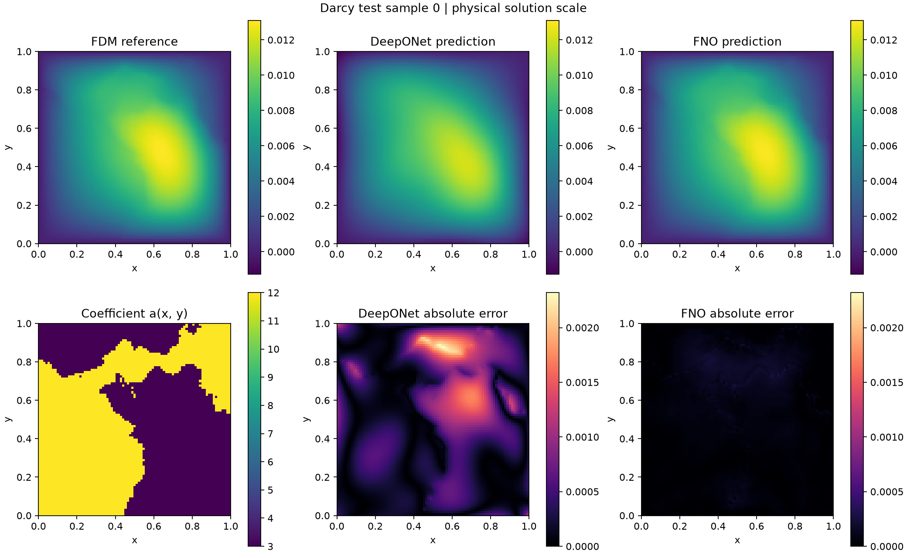

# OperatorBench

OperatorBench is a research project for reproducible comparisons of
DeepONet and Fourier Neural Operator (FNO) on PDE operator-learning tasks.

The immediate focus is a complete 2D Darcy workflow:
data generation, storage, preprocessing, model training, and evaluation.
Burgers experiments are planned as a subsequent extension.

## Current status

The initial baseline is a 2D Darcy coefficient-to-solution task (`a_to_u`)
on an 85 x 85 grid, using binary coefficients, a fixed source `f = 1`,
and homogeneous Dirichlet boundary conditions.

### Implemented and checked

- Binary coefficient generation and a flux-form finite-difference solver.
- Scalar and spatially varying source support in the solver.
- Constant and sine source generators.
- Numerical verification using a smooth, constant-coefficient manufactured solution.
- Dataset generation, NPZ storage, and loading.
- Training/validation/test splits with 1,000/200/200 samples.
- Normalization fitted using training data only.
- Model-specific input preparation for DeepONet and FNO.
- DeepONet and FNO implementations migrated from the existing notebooks.
- Forward, loss/backward, and fixed-batch learning checks.
- Shared training and validation with validation-based best-model selection.
- Checkpoint saving and resuming, including the FNO integration check.
- Completed 25,000-update CPU baseline training for both models.
- Evaluated both validation-selected checkpoints on the same 200 held-out test samples.
- Saved aggregate metrics, per-sample errors, physical-scale predictions, and comparison figures.

See [Darcy baseline test results](#darcy-baseline-test-results) for the results,
or [Run with VS Code](#run-with-vs-code) for execution instructions.

The code supports CPU and CUDA device selection. The reported full training
runs used CPU; full GPU baseline experiments remain pending.

### Remaining work

- Repeat baseline experiments across training seeds and study model-specific tuning budgets.
- Verify notebook-to-module numerical equivalence under aligned settings.
- Extend reference-solution verification to variable and discontinuous coefficients.
- Validate higher-resolution datasets and model execution, including 421 x 421 grids.
- Add configurable positive lognormal coefficient fields.
- Implement sample-varying source datasets and complete `f_to_u` and `af_to_u` workflows.

This completes the first fixed-configuration Darcy comparison, not the entire
benchmark project. Source-array support in the solver does not yet imply
support for all source-input learning tasks. The current baseline remains `a_to_u`.

## Darcy baseline test results

Both validation-selected checkpoints were evaluated on the same 200 held-out test samples.
No training or checkpoint selection was performed using the test set.

| Model | Selected update | Mean test relative L2 (%) | Mean sample maximum absolute error | Worst absolute error |
| --- | ---: | ---: | ---: | ---: |
| DeepONet | 24600 | 6.2474 | 1.776493e-03 | 3.514425e-03 |
| FNO | 25000 | 0.7630 | 2.527655e-04 | 5.811381e-04 |

Relative L2 is computed per sample and then averaged over 200 samples.
Absolute errors are measured after restoring the physical solution scale.
All grid points, including boundary points, are included. The worst absolute
error is the maximum over all test samples and grid points.

- [Full metric table](docs/results/darcy_test_seed2026_01/comparison.csv)
- [Per-sample errors](docs/results/darcy_test_seed2026_01/per_sample.csv)
- [Recorded settings, environments and fingerprints](docs/results/darcy_test_seed2026_01/metadata.json)

### Prediction examples

Sample indices 0, 1 and 2 were selected before inspecting prediction errors.
Within each figure, the reference and predictions share a color scale;
the two absolute-error panels also share a color scale.



Additional examples: [sample 1](docs/figures/darcy_test_seed2026_01/sample_001.png),
[sample 2](docs/figures/darcy_test_seed2026_01/sample_002.png).

### Interpretation and limitations

These are results for the initial binary-coefficient, fixed-source Darcy baseline,
with one training initialization seed per model. They do not establish universal
model superiority. Test-sample variability is not variability across training seeds.
The targets are finite-difference reference solutions; reference accuracy for
discontinuous coefficients and higher-resolution datasets remains to be verified.

## Run with VS Code

VS Code is the editor; the selected workspace and Python interpreter determine
where the computation runs. Opening a local checkout runs on your computer.
Connecting VS Code to a Codespace runs on the remote Codespace instead.

### Choose an execution path

| Goal | Required local files | Where to start |
| --- | --- | --- |
| Try basic checks | Source code only | Setup and basic checks below |
| Train a new baseline | Source code; generate the dataset first | Full workflow below |
| Evaluate existing trained models | Source code, the original dataset, and both `best.pt` files | Existing-checkpoint evaluation below |

Generated datasets and checkpoints are excluded from Git. A fresh clone does
not contain trained models. The repository publishes small result tables,
figures, and recorded metadata; it does not currently provide a checkpoint
download release. Generate and train locally, or obtain the original artifacts
from the experiment owner.

### 1. Open the repository

Install Git, a supported Python interpreter, VS Code, and Microsoft's Python
extension for VS Code. Python 3.11 is a suitable starting point for a new local
environment; the recorded benchmark environment is documented separately in
the published result metadata.

In VS Code, use `Git: Clone` from the Command Palette and clone
[this repository](https://github.com/HJang0820/OperatorBench).
Open the cloned `OperatorBench` folder, not its parent directory.
Then select **Terminal > New Terminal**.

If you already have a working Codespace with the dependencies installed,
skip the fresh-environment installation steps. Do not reinstall packages
immediately before demonstrating existing results.

### 2. Prepare a CPU environment

The setup commands below are for a **new** environment. They are installation
instructions, not a pinned dependency lockfile. Exact results across package
versions, devices, and operating systems are not guaranteed to be identical.
See the published metadata for the recorded training and evaluation environments.

#### Local Windows workspace in VS Code

Run these commands in the VS Code terminal from the repository root:

```powershell
python --version
python -m venv .venv
.\.venv\Scripts\python.exe -m pip install --upgrade pip
.\.venv\Scripts\python.exe -m pip install numpy scipy matplotlib
.\.venv\Scripts\python.exe -m pip install torch --index-url https://download.pytorch.org/whl/cpu
```

Use `Python: Select Interpreter` from the Command Palette and choose
`.venv\Scripts\python.exe`. The explicit interpreter paths below do not require
PowerShell activation scripts or execution-policy changes.

```powershell
.\.venv\Scripts\python.exe -m scripts.check_darcy
.\.venv\Scripts\python.exe -m scripts.check_darcy_inference
```

#### Linux or a new Codespaces environment

```bash
python -m venv .venv
source .venv/bin/activate
python -m pip install --upgrade pip
python -m pip install numpy scipy matplotlib
python -m pip install torch --index-url https://download.pytorch.org/whl/cpu
python -m scripts.check_darcy
python -m scripts.check_darcy_inference
```

These checks do not train a production model. The first checks a numerical
Darcy solution and saves a diagnostic figure; the second uses small artificial
arrays to check inference and error calculations. Expected messages include:

```text
Basic solver checks passed.
Darcy inference and metric checks passed.
```

The scripts are run with `python -m` from the repository root. This project
does not currently require an editable package installation.

For CUDA, install a suitable build using the
[official PyTorch installation guide](https://pytorch.org/get-started/locally/).
The CPU installation above deliberately does not enable CUDA. A laptop's brand
does not determine CUDA availability; compatible hardware, drivers, and a CUDA
build of PyTorch are required. CPU execution remains supported.

### 3. Generate data and train new models

The committed split generator uses `SMALL_RUN = False` to generate the full
1,000/200/200 split. If a matching cached dataset exists, the generator loads
and checks it instead of regenerating it. Full training is not a quick demo
and can take many hours on CPU.

**Windows VS Code terminal:**

```powershell
.\.venv\Scripts\python.exe -m scripts.generate_darcy_splits
.\.venv\Scripts\python.exe -u -m scripts.train_darcy --model deeponet --device cpu --run-name deeponet_cpu_local_01
.\.venv\Scripts\python.exe -u -m scripts.train_darcy --model fno --device cpu --run-name fno_cpu_local_01
.\.venv\Scripts\python.exe -u -m scripts.evaluate_darcy --device cpu --batch-size 4 --deeponet-checkpoint outputs/deeponet_cpu_local_01/best.pt --fno-checkpoint outputs/fno_cpu_local_01/best.pt --output-dir outputs/darcy_test_local_01
```

**Linux / Codespaces terminal with the environment active:**

```bash
python -m scripts.generate_darcy_splits
python -u -m scripts.train_darcy --model deeponet --device cpu --run-name deeponet_cpu_local_01
python -u -m scripts.train_darcy --model fno --device cpu --run-name fno_cpu_local_01
python -u -m scripts.evaluate_darcy --device cpu --batch-size 4 --deeponet-checkpoint outputs/deeponet_cpu_local_01/best.pt --fno-checkpoint outputs/fno_cpu_local_01/best.pt --output-dir outputs/darcy_test_local_01
```

Run the commands sequentially. Use a new run name for a new experiment.
For an interrupted run, use the same training command with `--resume` only
when its `last.pt` exists and the saved settings, source files, and execution
environment still match. Do not start over in or delete an existing run folder.

Adding Python modules can also change the training code fingerprint. Freeze the
source tree and environment while a resumable experiment is in progress.
Cross-machine or CPU-to-GPU training-state migration is not currently supported.

### 4. Evaluate existing checkpoints on another computer

For example, to evaluate the original experiment on a Lenovo laptop:

1. Open a local clone in VS Code and prepare its Python environment as above.
2. Obtain the following **original files** from the experiment machine.
3. Place them at the same repository-relative locations shown below.
4. Run evaluation without training.

```text
OperatorBench/
├── data/
│   └── darcy/
│       └── darcy_binary_f1_v1_full_N85_train1000_val200_test200_seeds2022-2024-2025.npz
└── outputs/
    ├── deeponet_full_seed2026_01/
    │   └── best.pt
    └── fno_full_seed2026_resume_01/
        └── best.pt
```

Do not recreate the dataset as a substitute for the original artifact.
The evaluator checks the dataset file's SHA-256 fingerprint. Using the same
random seeds on another environment does not guarantee an identical file.
Copy the original NPZ file without opening and resaving it. Do not copy a
virtual environment between computers; recreate the environment locally.

The evaluator also checks relevant model/preprocessing source files against
the checkpoint. Use the source version that matches those files. Repository
attributes preserve LF line endings for Python files on Windows. If a source
fingerprint differs, investigate it rather than disabling the check.

**Windows VS Code terminal:**

```powershell
.\.venv\Scripts\python.exe -u -m scripts.evaluate_darcy --device cpu --batch-size 4 --output-dir outputs/darcy_test_lenovo_01
```

**Existing Codespaces environment:**

```bash
python -u -m scripts.evaluate_darcy --device cpu --batch-size 4 --output-dir outputs/darcy_test_live_demo_01
```

The checkpoint paths default to the original run folders shown above.
`--output-dir` is a new result folder, not a checkpoint folder. An existing
output folder is never overwritten; choose another name, such as a suffix
`_02`, for a repeated demonstration.

Successful execution ends with `Darcy test evaluation completed.`
Open the generated CSV files and PNG figures in the VS Code Explorer.
Predictions are saved in physical units and can be replotted without training.
The original `best.pt` files are read but not modified.

Checkpoint inference on a different computer is distinct from resuming
optimizer state. Record the new evaluation environment and allow for numerical
differences between environments. Do not use test results to retune the models.


## Darcy problem

We consider the steady elliptic problem

$$
-\nabla \cdot (a(x)\nabla u(x)) = f(x),
\qquad x \in (0,1)^2,
$$

with homogeneous Dirichlet boundary conditions:

$$
u(x) = 0, \qquad x \in \partial\Omega.
$$

Here, `a` is the positive coefficient field, `f` is the source term,
and `u` is the solution field.

### Current diagnostic configuration

- Model input for the initial task: coefficient field `a`.
- Source term: `f = 1`.
- Coefficient values: `3` and `12`.
- Coefficient generation: thresholding a random cosine-basis expansion.
- The constant mode of the underlying random field is set to zero.
- Grid: `85 x 85` nodes, including boundary nodes.
- Boundary conditions: zero Dirichlet conditions on all four sides.
- Solver: flux-form five-point finite differences.
- Face coefficients: arithmetic averages of adjacent nodal coefficients.
- Linear system: solved using SciPy's sparse direct solver.

This is a locally generated baseline dataset configuration.
Exact equivalence to the original public FNO dataset has not been established.

### Planned input configurations

| Task | Model input | Fixed information |
| --- | --- | --- |
| `a_to_u` | Coefficient field `a` | A prescribed source, initially `f = 1` |
| `f_to_u` | Source field `f` | One prescribed coefficient field shared across samples |
| `af_to_u` | Coefficient and source fields `(a, f)` | Domain and boundary conditions |

The binary-coefficient diagnostic uses the constant source `f = 1`.
The numerical solver also supports spatially varying source arrays.

Constant and sine source generators are available.
The current dataset builder applies one shared source field to all samples.

Sample-varying source generation and the complete `f_to_u` and `af_to_u`
learning pipelines remain planned.

### Planned coefficient distributions

- Binary, discontinuous coefficients: current implementation.
- Positive lognormal coefficients with configurable spatial regularity: planned.

For lognormal coefficients, spatial regularity will be controlled by
the underlying Gaussian field. Exponentiation alone does not specify smoothness.

## Run the current Darcy diagnostic

Run the following commands from the repository root in your Python environment.

Install the diagnostic dependencies:

```bash
python -m pip install numpy scipy matplotlib
```

Run the checks and generate the figure:

```bash
python -m scripts.check_darcy
```

The script generates one coefficient field, computes its finite-difference
solution, checks basic properties, evaluates the discrete residual,
and saves a diagnostic figure.

Successful execution includes:

```text
Basic solver checks passed.
```

The figure is saved to:

```text
docs/figures/darcy_sample_N85_seed2022.png
```

### Example coefficient and finite-difference solution


This figure shows a numerical solution, not a neural-network prediction.
A small discrete residual checks consistency with the discrete equations;
it does not establish continuum accuracy or grid convergence.

## Numerical verification

### Source-array support and grid refinement

Run the verification script from the repository root:

```bash
python -m scripts.check_darcy_source
```

The script first checks that a scalar source `f = 1` and an equivalent
constant source array produce matching numerical solutions.

It then solves a manufactured-solution problem on the unit square with
homogeneous Dirichlet boundary conditions:

$$
a(x,y)=1,
$$

$$
u_{\mathrm{exact}}(x,y)=\sin(\pi x)\sin(2\pi y),
$$

$$
f(x,y)=5\pi^2\sin(\pi x)\sin(2\pi y).
$$

The same continuous problem is evaluated on each grid.
Each grid contains `N x N` nodes, including boundary nodes, with
spacing `h = 1 / (N - 1)`.

The relative L2 error is computed from the sampled solution arrays:

$$
E_h =
\frac{\|u_h-u_{\mathrm{exact}}\|_2}
{\|u_{\mathrm{exact}}\|_2}.
$$

### Results

| Grid size | Grid spacing | Relative L2 error | Observed order |
| --- | --- | --- | --- |
| 17 x 17 | 1/16 | 1.098931e-02 | — |
| 33 x 33 | 1/32 | 2.734955e-03 | 2.0065 |
| 65 x 65 | 1/64 | 6.829684e-04 | 2.0016 |

The observed order compares each grid with the preceding coarser grid:

$$
p =
\frac{\log(E_{\mathrm{coarse}}/E_{\mathrm{fine}})}
{\log(h_{\mathrm{coarse}}/h_{\mathrm{fine}})}.
$$

The error decreases by approximately a factor of four when the grid
spacing is halved. This is consistent with second-order convergence
for this smooth, constant-coefficient problem.

Successful execution ends with:

```text
Grid refinement checks passed.
```

### Scope and limitations

These results concern finite-difference discretization error, not
DeepONet or FNO prediction error.

The test verifies source-array handling and grid convergence for the
specified manufactured solution. It does not establish reference-solution
accuracy for discontinuous coefficient fields or validate 421 x 421
reference datasets. Those checks remain separate tasks.


## Generate and check a small Darcy dataset

Run the following commands from the repository root, using the
dependencies listed above.

### Check the source generators

```bash
python -m scripts.check_forcing
```

The implemented generators provide:

- A constant source field.
- A sine source field of the form
  `amplitude * sin(pi*x) * sin(2*pi*y)`.

### Generate, save, and reload 10 samples

```bash
python -m scripts.check_darcy_dataset
```

The current smoke-test configuration is:

| Setting | Value |
| --- | --- |
| Task | `a_to_u` |
| Number of samples | 10 |
| Grid | 85 x 85 nodes, including boundary nodes |
| Domain | Unit square |
| Coefficient | Binary fields with values 3 and 12 |
| Source | `f = 1`, shared across all samples |
| Boundary condition | Homogeneous Dirichlet |
| Seed | 2022 |
| Numerical solver | Flux-form five-point finite differences |
| Face averaging | Arithmetic |
| Solver arithmetic | `float64` |
| Stored field dtype | `float32` |

The script saves the dataset to:

```text
data/smoke/darcy_binary_f1_N85_n10_seed2022.npz
```

The file contains:

| Key | Shape or format | Meaning |
| --- | --- | --- |
| `A` | `(10, 85, 85)` | Coefficient fields |
| `F` | `(10, 85, 85)` | Source fields |
| `U` | `(10, 85, 85)` | Finite-difference solutions |
| `x` | `(85,)` | x coordinates |
| `y` | `(85,)` | y coordinates |
| `metadata_json` | JSON string | Task, grid, seed, source, coefficient, and solver settings |

Array indexing follows `A[sample, i, j] = a_sample(x[i], y[j])`.
The same convention applies to `F` and `U`. Coordinate arrays use `float64`.

The script checks field shapes, dtypes, finite values, coefficient values,
source values, and zero boundary values. It also compares the first
sample against a scalar-source solver call.

After saving, every array and the generation metadata are loaded and
compared with their in-memory counterparts.

Successful execution ends with:

```text
Dataset generation and save/load checks passed.
```

If the output file already exists, the script does not overwrite it.
Instead, it compares the existing file against the newly generated data.
A mismatch causes the check to fail.

This verification script regenerates the small dataset when rerun.
The training and evaluation workflows load the saved split dataset
without solving the PDE again.

### Load the saved file without regenerating data

Run this Python code from the repository root:

```python
import json

import numpy as np

path = "data/smoke/darcy_binary_f1_N85_n10_seed2022.npz"

with np.load(path, allow_pickle=False) as dataset:
    A = dataset["A"]
    F = dataset["F"]
    U = dataset["U"]
    x = dataset["x"]
    y = dataset["y"]
    metadata = json.loads(dataset["metadata_json"].item())

print(A.shape, F.shape, U.shape)
print(metadata["task"])
```

### Scope

This is a small data-generation and serialization check, not a completed
training dataset or a neural-operator benchmark result.

No train/validation/test split or normalization is applied.
The saved `U` fields are numerical solutions, not model predictions.
Reference-solution accuracy for discontinuous coefficients requires
separate validation.

Generated datasets are excluded from Git through `.gitignore`.


## Modular design

The following structure describes the implemented Darcy baseline components.
Paths are relative to the repository root.

```text
OperatorBench/
├── configs/
│   └── darcy_baseline.json       # Dataset, model, and training settings
├── operatorbench/
│   ├── __init__.py
│   ├── data_generation/
│   │   ├── __init__.py
│   │   ├── fields.py             # Binary coefficient generation
│   │   ├── forcing.py            # Constant and sine source generation
│   │   ├── darcy_fd.py           # Flux-form finite-difference solver
│   │   └── darcy_dataset.py      # Dataset generation, storage, and loading
│   ├── data/
│   │   ├── __init__.py
│   │   ├── datasets.py           # Dataset loading and access
│   │   ├── preprocessing.py      # Training-only normalization
│   │   └── model_inputs.py       # DeepONet and FNO input preparation
│   ├── models/
│   │   ├── __init__.py
│   │   ├── deeponet.py           # DeepONet model
│   │   └── fno.py                # Fourier Neural Operator model
│   ├── losses.py                # Relative L2 losses
│   ├── evaluation.py            # Batched relative L2 validation
│   ├── inference.py             # Batched predictions and physical-scale errors
│   └── training.py              # Training, validation, and checkpoint recovery
├── scripts/
│   ├── __init__.py
│   ├── check_darcy.py
│   ├── check_darcy_source.py
│   ├── check_forcing.py
│   ├── check_darcy_dataset.py
│   ├── generate_darcy_splits.py
│   ├── check_darcy_loader.py
│   ├── check_darcy_preprocessing.py
│   ├── check_darcy_model_inputs.py
│   ├── check_darcy_models.py
│   ├── check_darcy_backward.py
│   ├── check_darcy_fixed_batch.py
│   ├── check_darcy_training.py
│   ├── check_darcy_resume.py
│   └── train_darcy.py
├── docs/
│   └── figures/
│       └── darcy_sample_N85_seed2022.png
├── .gitignore
└── README.md
```

Generated datasets are stored under `data/`, and experiment outputs are
stored under `outputs/`. These directories are excluded from Git.

The current executable checks are located in `scripts/`.
The tree does not imply that every planned benchmark feature is implemented.

### Component responsibilities

| Component | Responsibility |
| --- | --- |
| `data_generation` | Generate coefficient/source fields, solve the PDE, and store numerical data and metadata. |
| `data` | Load saved data, apply training-derived normalization, and prepare model-specific inputs. |
| `models` | Define DeepONet and FNO forward computations. |
| `losses.py` | Compute relative L2 losses and per-sample errors. |
| `evaluation.py` | Evaluate relative L2 errors in batches without updating model parameters. |
| `training.py` | Run optimization and validation, select the best model, and save or restore training state. |
| `inference.py` | Generate batched predictions and compute errors from physical-scale solution fields. |
| `configs` | Record the settings for a specific baseline experiment. |
| `scripts` | Provide entry points for generation, diagnostic checks, and training. |

The evaluation utility is implemented and used during validation.
The final held-out test comparison and result reporting remain pending.

### Design principles

1. Keep numerical data generation separate from model training.
   Training should load saved data rather than solve the PDE again.

2. Preserve physical fields, coordinates, and generation metadata.
   Model-specific input layouts are constructed during preprocessing.

3. Fit normalization statistics using training data only.
   Apply the same statistics to validation and test data.

4. Use the same data splits and physical input information for both models.
   Record architecture and optimization settings explicitly.

5. Select the best model using validation data.
   Reserve the held-out test set for final evaluation.

6. Separate evaluation checkpoints from recovery checkpoints.
   `best.pt` stores the validation-selected model.
   `last.pt` stores the state needed to continue training.

7. Use a shared training implementation with CPU or CUDA device selection.
   The current resume implementation requires matching saved settings
   and execution environment; CPU-to-GPU migration is not yet supported.

8. Preserve the existing notebook implementations where practical.
   Treat code migration, numerical-method changes, and architecture
   changes as separate activities.

9. Record configurations, random seeds, dataset fingerprints, and
   execution-environment information for traceability.

10. Distinguish implemented features, completed checks, preliminary
    validation results, and final test-set benchmark results.

### Extension scope

The current training baseline is `a_to_u` with binary coefficients
and a fixed source `f = 1`.

The numerical solver accepts source arrays, but sample-varying source
datasets and the complete `f_to_u` and `af_to_u` learning workflows
remain planned.

Configurable positive lognormal coefficient fields and higher-resolution
validation are also future extensions. Supporting these tasks requires
additional implementation and testing, not only changing an input label.

## Darcy roadmap

Checked items indicate implemented work or completed checks.
They do not imply that the full benchmark has been completed.

### Implemented and checked

- [x] Extract the binary coefficient generator from the existing workflow.
- [x] Extract the flux-form finite-difference Darcy solver.
- [x] Add basic solver checks and a diagnostic coefficient/solution figure.
- [x] Support scalar and spatially varying source fields in the solver.
- [x] Add constant and sine source generators.
- [x] Generate a 10-sample dataset and verify NPZ save/load consistency.
- [x] Generate and save the initial 1,000/200/200 training/validation/test splits.
- [x] Add reusable dataset loading.
- [x] Fit normalization statistics using training data only.
- [x] Add DeepONet branch/trunk and FNO grid input preparation.
- [x] Migrate the DeepONet and FNO model implementations.
- [x] Check model forward outputs and loss/backward computations.
- [x] Check that both models can reduce loss on a small fixed batch.
- [x] Implement shared training and validation.
- [x] Implement batched per-sample relative L2 evaluation.
- [x] Select and save the best model using validation data.
- [x] Implement and check checkpoint saving and resuming.
- [x] Pass the two-step FNO save/resume integration check.
- [x] Verify approximately second-order convergence for a smooth, constant-coefficient manufactured solution.

### Initial baseline milestone

- [x] Complete the 25,000-update CPU DeepONet baseline run.
- [x] Complete the 25,000-update CPU FNO baseline run.
- [x] Check batched inference and physical-scale error calculations.
- [x] Evaluate both validation-selected models on the same 200 test samples.
- [x] Report mean test relative L2 and maximum absolute errors.
- [x] Add reference, prediction, and error plots for both models.
- [x] Publish small result artifacts and recorded settings/environments.
- [x] Document VS Code execution and existing-checkpoint evaluation.

### Further verification and extensions

- [ ] Verify notebook-to-module numerical equivalence under aligned settings.
- [ ] Repeat baseline experiments across training seeds.
- [ ] Study model-specific tuning budgets and accuracy-versus-compute trade-offs.
- [ ] Validate reference-solution accuracy for spatially varying and discontinuous coefficients.
- [ ] Validate higher-resolution reference generation, including 421 x 421 grids.
- [ ] Check model memory requirements and execution at higher resolutions.
- [ ] Support batch-wise device transfer during training for datasets that do not fit in GPU memory.
- [ ] Run and document full GPU baseline experiments.
- [ ] Add configurable positive lognormal coefficient fields with controlled spatial regularity.
- [ ] Add sample-varying source generation.
- [ ] Implement and check the complete `f_to_u` learning workflow.
- [ ] Implement and check the complete `af_to_u` learning workflow.
- [ ] Extend the dataset schema and configuration interface for additional tasks.
- [ ] Verify the end-to-end setup on additional machines, including the Lenovo laptop.
- [ ] Provide and validate a pinned reproducibility environment.

The initial fixed-configuration Darcy comparison is complete.
Burgers support will follow as a subsequent extension.

## References

- [Fourier Neural Operator](https://arxiv.org/abs/2010.08895)
- [PDEBench](https://github.com/pdebench/PDEBench)